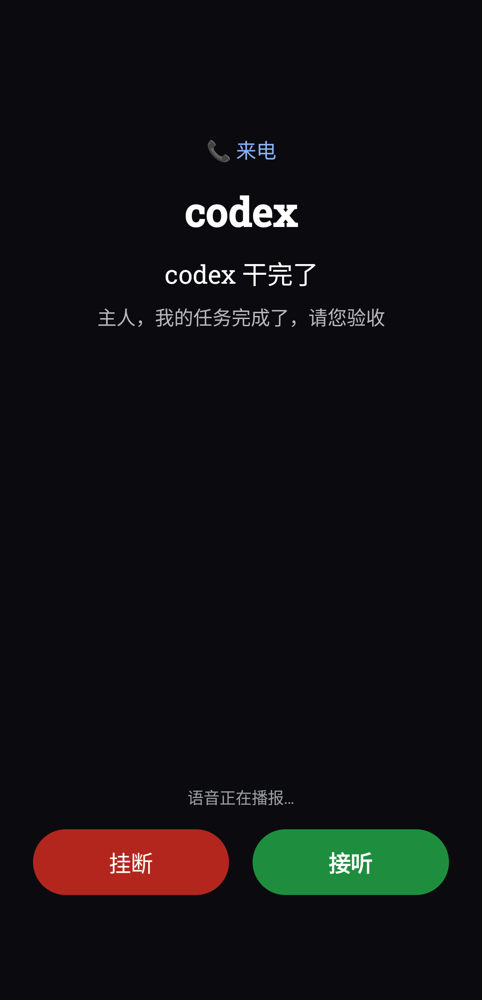
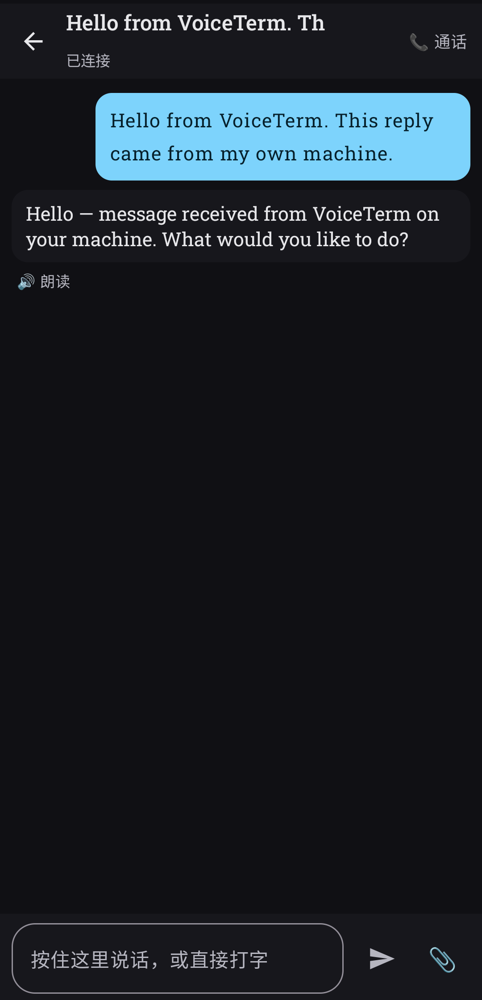

# VoiceTerm

**一个可以给你打电话的语音 AI Agent 终端。**
按住输入栏说话，松手，Agent 回答；它干完活或等你审批时，会像来电一样响铃并念给你听。

<p align="center">
  
  
</p>

<p align="center">
  <sub><b>左：</b>干完活或等你审批时，它会像来电一样打给你。<b>右：</b>按住说话，它开口回答。</sub>
</p>

**简体中文** | [English](README.md)

VoiceTerm = 一个 Android 应用 + 一个小小的 Node 网关（**hub**，零 npm 依赖）。
hub 说的是 [cc-connect](https://github.com/chenhg5/cc-connect) 官方文档里的 **bridge 协议**，
所以你已经在 cc-connect 后面跑着的 Agent —— Claude Code、Codex、OpenCode、Gemini CLI，
以及任何有命令行的东西 —— 会直接出现在手机列表里，点一下就能聊。

中间没有云：手机和你的机器在局域网上直连，出门时自动切到你自己的 HTTPS 入口
（Cloudflare Tunnel、反代或 VPN）。

---

## 为什么不直接用 IM 机器人？

cc-connect 已经把 Agent 接进了 Telegram / 飞书 / Slack / Discord。但那些应用是**文字优先**的：
你打字，你读字。VoiceTerm 面向的是"手和眼睛都忙着"的场景 —— 开车、走路、做饭、半夜一点躺床上
—— 这时候你更需要**说和听**：

| | IM 机器人（cc-connect 原生） | VoiceTerm |
|---|---|---|
| 输入 | 打字 / 录一段再试听 | 按住说话，局域网里边说边出字 |
| 输出 | 读文字，点一下才朗读 | 每条回复都能念，说话可打断 |
| 延迟 | 经过第三方服务器，秒级 | 局域网优先，到自家机器约 30 ms |
| 控制权 | 别人的 App、别人的规则 | 自己的设备、自己的令牌、无遥测 |
| 需要你的时候 | 又一条躺在列表里、会被划成未读的消息 | **像来电一样响** —— 铃声＋震动＋语音念出来，念到你处理 |

两者不冲突：打字用 cc-connect，说话用 VoiceTerm。

## 干完活，它会打电话给你

这是 IM 机器人从结构上做不到的事：一条 IM 通知只是消息列表里又一行，划过去就忘了。
VoiceTerm 会**升级打扰**，而且只在你真的被卡住的两个时刻：

| 触发 | 发生什么 |
|---|---|
| **Agent 把活干完了** | 弹全屏"来电窗"（锁屏也能弹）、响铃、循环震动，并念一句：*"主人，我的任务完成了，请您验收。"* |
| **Agent 在等你审批** | 同样的来电式提醒，标题是「某某 Agent 需要你确认」，念的是：*"主人，有任务需要你审批了。"* |

```text
每 5.5 秒   再念一遍（TTS）；TTS 不通就退回铃声，至少让你听得见
最多 20 遍   约 2 分钟，之后不再吵；通知文字一直留着，直到你处理掉
接听         进来电窗，Agent 直接开口；点"挂断"立刻停
立即打断     接听 / 挂断 / 打开那条会话 / 服务停止，任何一个动作都会马上停
故意不响     普通回复只给一条普通通知（响一声）；
             不是"发问的那台"手机不响（按 replyCtx 判归属）；
             你正在看着这条会话时不响
```

所以可以放心把手机塞兜里干别的：Agent 干完或被卡住时它会**打电话给你**，而不是赌你记得回来看角标。

念的那句话默认是中文，想换措辞或换成别的语言，改 `HubService.kt` 里的 `val script = when { … }`
（两个分支各一行）。提醒音量跟随手机铃声音量；不想要这套提醒，可以在系统设置里关掉
「任务完成 / 待审批」这个通知渠道，其余功能不受影响。

## 能力

- **按住说话** —— 按住输入栏、说话、松手。局域网：边说边出字（分段增量转写）；
  公网线路：松手后整段只转一次（少几次往返，明显更快）。
- **把回答念出来** —— 每条回复都有 🔊；服务端 TTS，流式播放，点一下停。
- **通话模式** —— 全双工：持续听、流式播报、说话即打断。
- **该叫你的时候会叫你** —— 任务完成 / 等你审批时像来电一样响铃并念出原因，普通回复不吵人。
- **所有 Agent 一个列表** —— cc-connect 里每个 `[[projects]]` 自动出现。
- **会话** —— 每个 Agent 一条主线加若干命名会话；**第一句话就是会话名**。
- **富消息** —— Markdown、带按钮的卡片、图片（全屏双指缩放）、文件交系统应用打开、
  斜杠命令原样转发给 Agent。
- **双网络一台手机** —— 启动时和每次网络切换都探测局域网与公网，谁快连谁。
- **两台手机一套后端** —— `deviceId` 相同则共用同一段上下文；只让"发问的那台"响铃，
  另一台静默记录。
- **面很小** —— hub 只用 Node 内置模块（Node ≥ 22），App 只用原生 AndroidX + Compose。
- **没有默认口令、没有统计、没有账号。** 令牌是放在你自己机器上的文件。

## 架构

```
   手机（VoiceTerm，Kotlin/Compose）          你的机器
   ┌──────────────────────────┐   HTTP/SSE   ┌────────────────────────────────────┐
   │ Agent 列表               │ ───────────► │ hub  :8097                         │
   │ 按住说话的录音器         │              │   POST /v1/sessions/:agent/message │
   │ TTS 播放 / 通话模式      │ ◄─────────── │   POST /v1/sessions/:agent/voice   │
   │ Room 本地库（聊天记录）  │              │   GET  /v1/sessions/:agent/events  │
   └──────────────────────────┘              │   POST /v1/asr、/v1/tts            │
                ▲                            │            │ WebSocket（bridge）   │
                │                            │            ▼                      │
   可选：https://hub.example.com ──────────► │      cc-connect :9810             │
   （Cloudflare Tunnel / Caddy / nginx）      │            │ stdio / CLI           │
                                              │   claude · codex · opencode · …    │
                                              └────────────────────────────────────┘
```

* **hub** —— 给手机提供 HTTP + SSE；每条上游一个 bridge 协议的 WebSocket 客户端；
  一层极薄的 OpenAI 兼容 TTS/ASR 门面；可选地直接 spawn 本机 CLI Agent（例如 Hermes）。
* **app** —— Compose 界面、按住说话录音、SSE 流式渲染、Room 落库、前台服务与通知、网络切换重选线路。

## 快速开始

### 1. cc-connect（Agent 那一侧）

装好并配置 cc-connect，至少一个 project，并且**打开 bridge**：

```bash
# ~/.cc-connect/config.toml
[bridge]
enabled = true
port    = 9810
path    = "/bridge/ws"
token   = "CHANGE_ME"            # 随便一串够长的随机字符
```

把 project 绑到某个平台（飞书、Telegram…）以及怎么指向你的 Agent CLI，见
[cc-connect 文档](https://github.com/chenhg5/cc-connect)。

### 2. hub（手机那一侧）

```bash
git clone https://github.com/yabolee-kkk/voiceterm && cd voiceterm
./deploy/install.sh          # 生成令牌、写 systemd 用户服务、起服务
curl -s localhost:8097/ping  # {"ok":true,"hub":"voiceterm","port":8097}
```

`deploy/install.sh` 全程不打印令牌：它把 `~/.config/voice-hub/{api-token,bridge-token,env}`
写成 `600`。想用 Docker：`docker compose -f deploy/docker-compose.yml up -d`。

语音是可选的，但加上体验差别很大 —— 指向任意 OpenAI 兼容的语音端点即可：

```bash
# ~/.config/voice-hub/env
GATEWAY_URL=http://127.0.0.1:8080      # TTS+ASR 基地址
TTS_MODEL=你的-tts-模型
ASR_MODEL=你的-asr-模型
# 可选：本机 whisper 兜底
WHISPER_URL=http://127.0.0.1:19980
```

不配语音也能用：文字进、文字出。

### 3. App

```bash
cd voiceterm && ./gradlew :app:assembleDebug
adb install -r app/build/outputs/apk/debug/app-debug.apk
```

打开「设置」填四项：

| 字段 | 示例 | 说明 |
|---|---|---|
| 服务地址（局域网） | `http://192.0.2.10:8097` | 你那台机器的局域网 IP |
| 公网地址 | `https://hub.example.com` | 可选；局域网连不上时才用 |
| 访问令牌 | `~/.config/voice-hub/api-token` 的内容 | 永远不会进 Git 或 APK |
| 设备标识 | `dev01` | 两台手机填同一个即共用一段上下文 |

局域网明文 `http` 需要在 `app/src/main/res/xml/network_security_config.xml` 里加一行你的 IP
（文件里有注释示例）。公网一律用 `https`。

## 配置参考（hub）

全部是环境变量；除了令牌，其它都有可用默认值。

| 变量 | 默认 | 含义 |
|---|---|---|
| `HUB_PORT` | `8097` | 给手机用的 HTTP 端口 |
| `HUB_BIND` | `0.0.0.0` | 绑定地址 |
| `HUB_DEVICE` | `dev01` | 会话键里用的默认设备标识 |
| `HUB_AGENTS` | *（读 cc-connect 配置）* | 逗号分隔的 Agent 列表，覆盖自动发现 |
| `BRIDGE_URL` | `ws://127.0.0.1:9810/bridge/ws` | cc-connect 的 bridge 地址 |
| `BRIDGE_TOKEN_FILE` | `~/.config/voice-hub/bridge-token` | bridge 令牌文件 |
| `HUB_BRIDGES` | *（未设）* | JSON 数组，加更多 cc-connect 上游，可带 `agents` 限定归属 |
| `GATEWAY_URL` | `http://127.0.0.1:8080` | OpenAI 兼容的 TTS/ASR 基地址 |
| `TTS_MODEL` / `ASR_MODEL` / `TTS_VOICE` | 厂商默认 | 语音模型名与音色 |
| `WHISPER_URL` | *（空）* | 本机 whisper 兜底地址 |
| `HERMES_BIN` / `HERMES_CWD` / `HERMES_DISABLE` | `hermes` / `$HOME` / 未设 | 可选的直连 CLI Agent |

## 安全模型

* 手机的 bearer 令牌是一个 `600` 的文件，只在 App 里输一次；不会编进 APK、不会进 Git、
  除了你自己的 hub 之外不发给任何地方。
* 明文 HTTP 只放行你显式写进白名单的主机（默认只有回环）。离开局域网的流量一律 HTTPS。
* hub 是单用户服务。要暴露到公网，请在前面叠一层你自己的认证（Cloudflare Access、mTLS、WireGuard）。
* 什么都不外传：没有遥测、没有更新检查、没有账号。

发现问题怎么报，见 [SECURITY.md](SECURITY.md)。

## 与 cc-connect 的关系

VoiceTerm **不是** cc-connect 的分支，也**不打包**它。它是一个*外部平台适配器*：hub 通过
官方文档里的 [bridge 协议](docs/bridge-notes.md)（WebSocket、`register` / `message` / `card_action`）
连过去 —— 这正是该协议被设计出来的用途。cc-connect 自己装、自己升级，VoiceTerm 照常工作。

如果哪天 cc-connect 内置了语音，这个项目依然有用：它是"在你自己的网络里跟 Agent 说话"的参考客户端。

## 状态

`1.0.1` —— 两台手机（Android 14 / Android 9）、五个 Agent 日常在用。变更见
[CHANGELOG.md](CHANGELOG.md)。已知限制：

* 公网链路（Cloudflare 免费隧道）每次请求 1–3 秒；局域网才是好路径。
* 锁屏后继续录音还不支持（Android 后台麦克风规则）；正在跟踪，尚未实现。
* 口述的斜杠命令不做归一化（说"斜杠 status"不会变成 `/status`）。
* 每个 `deviceId` 只"回答"一台手机 —— 这是刻意的设计，不是 bug。

## 开发

```bash
npm run check                 # hub 语法检查
node tools/selftest.js        # 对运行中的 hub 跑一遍端到端自测
adb reverse tcp:8097 tcp:8097 # USB 调试时让手机直接用本机 hub
```

调试版接受广播，可以从命令行驱动界面：

```bash
adb shell am broadcast -a ai.local.voiceagent.DEBUG_FIRE_CALL    --es agent codex   # 触发一次来电提醒
adb shell am broadcast -a ai.local.voiceagent.DEBUG_SEND_TEXT   --es text "hello"
adb shell am broadcast -a ai.local.voiceagent.DEBUG_ADD_ATTACH  --es path /sdcard/x.pdf --es kind file
adb shell am broadcast -a ai.local.voiceagent.DEBUG_PICK_FILES  --es paths "a.pdf,b.png"
```

细节见 [docs/development.md](docs/development.md)。

## 许可证

Apache-2.0。cc-connect 是 [@chenhg5](https://github.com/chenhg5) 的独立项目，本项目**不包含**它的
源码或二进制，它自己的许可证对它生效。
